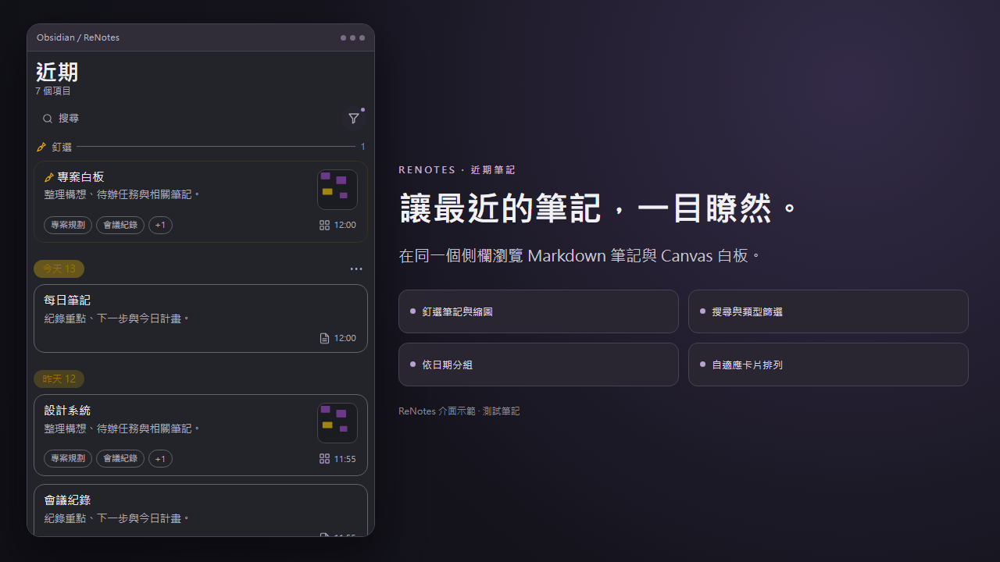
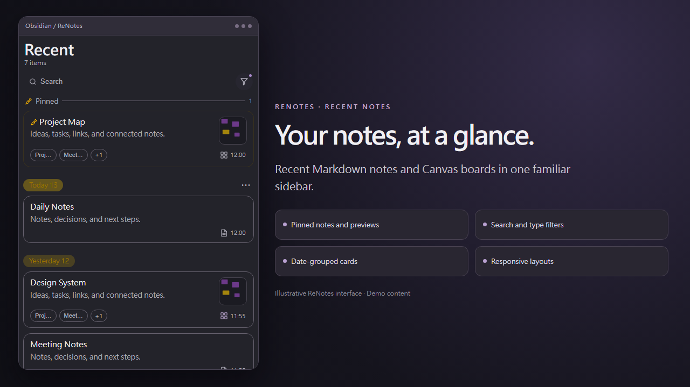
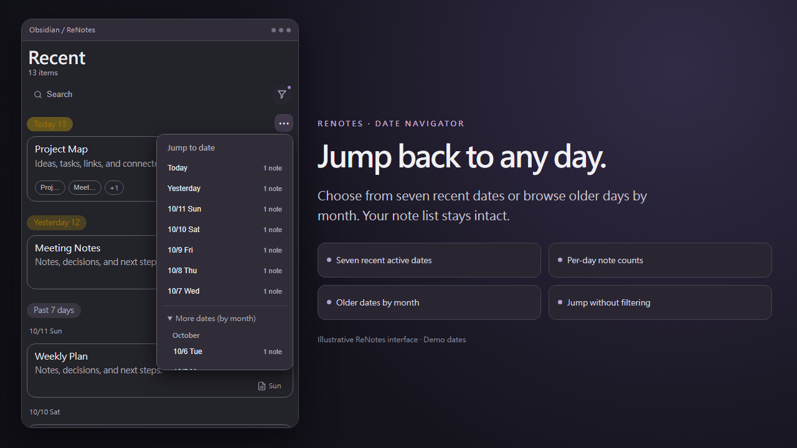
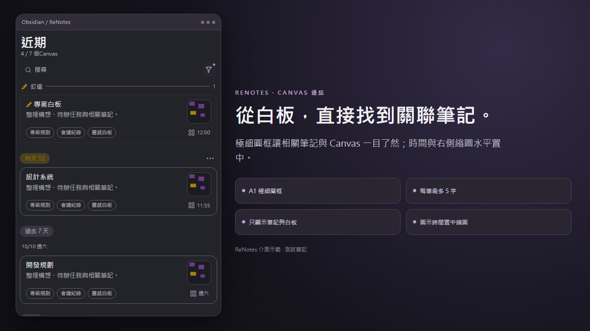

# ReNotes

**Obsidian 的近期筆記與 Canvas 側欄 · A recent-notes sidebar for Obsidian**

[繁體中文](#繁體中文) · [English](#english) · [下載最新版本 / Download](https://github.com/jason6666h/ReNotes/releases/latest)

## 功能縮圖 / Feature previews

| 繁體中文 · Recent notes | English · Recent notes |
| --- | --- |
|  |  |

**日期跳轉 / Date navigation**

**Canvas 連結筆記 / Linked Canvas documents**

> Screenshots use the ReNotes interface with illustrative sample notes. / 圖片以 ReNotes 介面與示範筆記呈現。

## 繁體中文

ReNotes 將 Markdown 筆記與 Canvas 白板集中在 Obsidian 的近期側欄，搭配釘選、日期分組、搜尋與縮圖，快速找回正在使用的內容。

### 主要功能

- **近期筆記與白板**：Markdown 和 Canvas 共用卡片列表，支援修改時間、有效編輯時間、開啟時間等排序方式。
- **A1 連結筆記圓框**：Canvas 下方只顯示 `.md` 與 `.canvas` 關聯文件。每個圓框最多顯示 5 字，滑鼠停留可查看完整名稱。
- **縮圖與資訊列**：支援筆記圖片與 Canvas 節點縮圖，類型圖示與時間水平置中對齊縮圖。
- **7 個日期快速跳轉**：日期標題右側的 `⋯` 顯示最近 7 個有筆記的日期及筆數；「更多日期」依月份展開。選擇日期只移動捲動位置，不篩選清單。
- **釘選、搜尋與篩選**：可依筆記類型、資料夾、標籤與排序條件調整列表。
- **自適應版面**：精簡、標準、寬鬆三種密度，支援側欄寬度調整與手機介面。
- **桌面拖曳**：將 Markdown 卡片的拖曳把手拖入 Obsidian Canvas，建立筆記引用。

### 介面語言

支援 **繁體中文**與 **English**。前往 `Obsidian 設定 → 社群外掛 → ReNotes → 介面語言` 選擇：

- **自動（跟隨 Obsidian）**：跟隨 Obsidian 的英文／繁體中文語言設定。
- **繁體中文**：固定使用繁體中文介面。
- **英文**：固定使用英文介面。

側欄、設定與選單會依選擇切換。若命令面板中的既有指令名稱仍是原語言，重新載入外掛即可。

### 安裝

1. 前往 [Releases](https://github.com/jason6666h/ReNotes/releases/latest)，下載最新版 `ReNotes-v1.2.2.zip`。
2. 將 `main.js`、`styles.css`、`manifest.json` 解壓縮到 Vault 的 `.obsidian/plugins/recent-notes-feed/`。
3. 重新啟動 Obsidian，於「設定 → 社群外掛」啟用 **ReNotes**。

外掛 ID：`recent-notes-feed`。Manifest 所列最低 Obsidian 版本：`1.4.0`。

## English

ReNotes brings recent Markdown notes and Canvas boards into one Obsidian sidebar, with card previews, pinned items, date navigation, and flexible sorting.

### Highlights

- **Recent notes and Canvas boards** with multiple sort modes, including effective edit time.
- **A1 fine-outline linked-document chips** for `.md` and `.canvas` files beneath Canvas cards.
- **Thumbnail previews**, with file-type icons and timestamps centered beneath the previews.
- **Seven-date navigator** with note counts and older dates grouped by month; selecting a date scrolls without filtering.
- **Pinned cards, search, and filters** for types, folders, tags, and sorting.
- **Responsive card densities** and mobile-friendly layouts.
- **Desktop Markdown-to-Canvas dragging** using an Obsidian file-reference drag handle.

### Interface language

Supports **Traditional Chinese** and **English**. Go to `Settings → Community plugins → ReNotes → Interface language` and choose **Auto (follow Obsidian)**, **Traditional Chinese**, or **English**.

The sidebar, settings, date labels, menus, and notifications use the chosen language. Reload ReNotes if command palette labels remain in the previous language.

### Installation

1. Download `ReNotes-v1.2.2.zip` from the [latest release](https://github.com/jason6666h/ReNotes/releases/latest).
2. Extract `main.js`, `styles.css`, and `manifest.json` into `.obsidian/plugins/recent-notes-feed/` inside your Vault.
3. Restart Obsidian and enable **ReNotes** under **Settings → Community plugins**.

Plugin ID: `recent-notes-feed`. The manifest specifies Obsidian `1.4.0` as the minimum version.

## Versions / 版本紀錄

- **v1.2.2** — Traditional Chinese + English interface, automatic/manual language selection, localized dates and menus, and feature screenshots.
- **v1.2.1** — Canvas linked-document chips display Markdown and Canvas files only.
- **v1.2.0** — A1 outline chips, thumbnail-aligned timestamps, and date navigation.

[完整更新紀錄 / Full changelog](CHANGELOG.md)

## License

This repository provides publicly viewable source code. No separate open-source license has been granted at this time.
